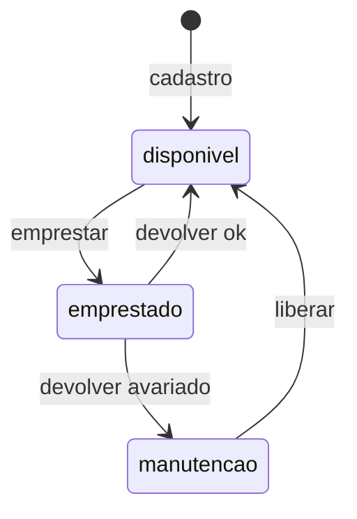

## Máquina de estados



## Como rodar

**Pré-requisitos:** Node.js instalado e acesso ao banco PostgreSQL do projeto (Supabase).

1. Clone o repositório e entre na pasta da API:

   ```
   git clone <url-do-repositorio>
   cd carrinho-escola/backend
   ```

2. Instale as dependências:

   ```
   npm install
   ```

3. Crie o arquivo `backend/.env` (ele não vai para o GitHub) com:

   ```
   PORT=3000
   DATABASE_URL=string_de_conexao_do_banco
   ```

   A string de conexão fica no botão **Connect** do painel do Supabase. Peça a senha do banco a quem criou o projeto, e nunca a envie por mensagem pública nem a coloque no código.

4. Suba a API:

   ```
   npm start
   ```

5. Teste em outro terminal:

   ```
   curl http://localhost:3000/health
   ```

   A resposta esperada é `{"status":"ok","banco":"conectado"}`.

**Problema com WSL:** se aparecer `ENETUNREACH` ao conectar no banco, o WSL não tem rota IPv6. Rode pelo PowerShell ou use a string do **Session pooler** do Supabase.